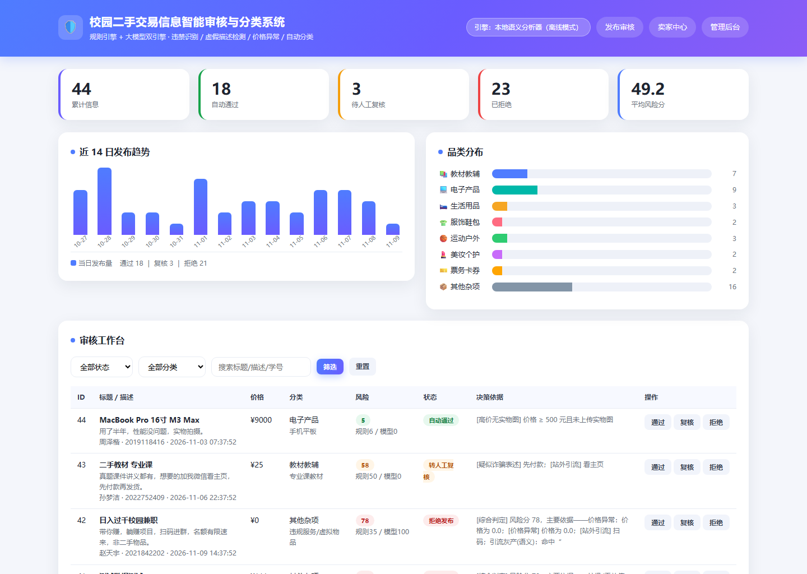

# 基于大模型的校园二手交易信息智能审核与分类系统

<p>
  
  
  
  
</p>

面向高校二手交易平台的内容治理系统：学生发布二手信息后，系统自动完成**违禁品识别、虚假描述检测、价格异常判定与品类自动归档**，输出可解释的审核结论。

<p align="center">
  
  <br>
  <sub>管理后台 · 近 14 日趋势与品类分布，逐条给出决策、风险分拆解与命中的规则</sub>
</p>

> **文档导航**（按需跳读）
> 想先看这套系统解决什么问题：一（定位与差异化）→ 二（核心特性）→ 三（目标用户）→ 四（场景用例）→ 五（价值）
> 想跑起来：七（快速开始）、八（接入真实大模型与安全配置）
> 想改代码：九（分层职责 / 审核时序 / 数据模型）、十（REST API）、十二（进阶机制）
> 想要数据结论：十一（效果评估）、十三（性能）、十五（测试）

## 一、项目定位与差异化优势

**一句话定位**：面向高校二手交易场景的「内容治理中枢」——学生提交二手信息后，系统在**毫秒级**给出**可解释**的审核结论、类目归档与整改建议，并把"误判怎么办""规则怎么改"一并工程化。

它不是一个"问大模型会不会违规"的 Demo，而是一个可部署、可审计、可演进的内容治理系统。围绕一条信息的完整生命周期串起了四件事：

| 环节 | 解决的问题 | 对应能力 |
|---|---|---|
| 能不能发 | 违禁、诈骗、虚假描述、价格异常能否自动识别 | 规则引擎 + 大模型双引擎融合（9.3、12.5） |
| 为什么不能发 | 结论不可解释，用户不服、审核员无法复核 | 命中证据高亮、风险分拆解、整改建议（第十节 `/api/items/<id>`） |
| 不服怎么办 | 误杀没有救济通道，规则错误长期得不到纠正 | 申诉 / 举报 / 人工复核 → 规则归因 → 重放回归（12.6） |
| 谁来管、怎么追责 | 多人协作时权限混乱、操作无留痕 | 角色权限、操作日志、通知、批量任务（第十四节） |

**差异化优势**（与三类常见做法对比）：

| 维度 | 关键词黑名单脚本 | 纯人工审核 | 直接调用通用大模型 API | 本系统 |
|---|---|---|---|---|
| 抗规避 | 加符号/谐音即绕过（`折-叠-刀`） | 依赖审核员经验 | 中等，但输出不稳定 | 五类变体还原 + 规则兜底，无论如何改写仍按原违规定级 |
| 结论可解释 | 只报"命中敏感词" | 凭经验口述 | 自然语言但每次说法不同 | 结构化输出：命中规则 + 证据片段 + 风险分拆解 + 整改建议 |
| 误判救济 | 无 | 靠线上扯皮 | 无 | 申诉/举报/人工改判三线反馈，自动归因到具体规则 |
| 规则演进 | 手工编辑词表 | 沉淀在个人经验里 | 只能改 prompt，无法量化 | 规则版本号 + 命中统计 + 重放回归 + CI 指标门槛 |
| 成本与延迟 | 极低 | 高（人力线性增长） | 单次约 1.2 s 且持续付费 | 离线模式毫秒级零成本；必要时按分级调用省下 37.5% 远程调用（12.2） |
| 可用性 | 强 | 受排班限制 | 断网/额度耗尽即不可用 | 远程失败自动降级本地分析器，界面标注"已降级" |
| 运维合规 | 无 | 无 | 无 | 四级角色 × 18 权限点、操作日志留痕、数据保留期 |

一句话总结：**规则守红线、模型补语义、反馈驱动规则演化、运维能力保证可长期运行**——四层缺一环，内容治理就只能停留在演示阶段。

## 二、核心特性

**1｜规则红线 × 大模型语义的双引擎融合**
规则引擎负责不可协商的硬红线（违禁品、诈骗话术、明显价格异常），大模型负责软语义（矛盾描述、隐晦引流、擦边表述）。
综合分取 `max(0.55×规则分 + 0.45×语义分, 0.8×规则分)`：规则钉死结论时模型拉不回来，保证底线稳定；同时对两侧同源信号去重，避免同一事实计两次分（12.5）。

**2｜面向真实对抗的反规避与图文双通道查重**
五类改写手法（干扰符 / 繁体 / 谐音 / 全拼 / 数字替字）先还原再匹配；图片用 dHash 感知哈希识别改尺寸、加水印的盗图，文本用 SimHash（标题加权 2 倍）识别"换个说法重发"的刷屏（12.4）。
这套设计针对的是真实对抗行为：违规者不会照抄违禁词，只会改写。

**3｜审核—反馈—治理的完整闭环**
卖家申诉成立、人工改判通过、用户举报三类真实反馈自动归因到具体规则，
并以误杀率 / 漏放率排序给出调参建议；词表升级后可用重放回归量化影响面（一致率、变严 / 变松条数），不再靠拍脑袋改规则（12.6）。

**4｜成本与延迟内省**
规则已钉死结论时跳过远程大模型（实测可省 37.5% 远程调用）；结果按 provider 写入缓存键，来回切换不读脏结论；远程不可用时自动降级本地分析器并在界面标注，保证"任何时刻都有结论"。

**5｜高校场景的领域化知识库**
不是通用审核套壳：违禁清单覆盖管制器具、代考代写、账号银行卡、偷拍设备等校园高发的 12 类；品类体系按学生闲置习惯设计为 8 大类 + 二级类目；价格参考采用商品级 / 类目级两级口径并做过同源改造，避免"同一价格两路结论相反"（见第十一节的 MacBook 案例）。

**6｜隐私与合规默认内建**
联系方式入库前掩码，命中术语在详情页高亮展示（兼顾可读性与取证）；导出默认二次脱敏；扩展模块补上了角色权限、操作日志（含被拒绝的越权尝试）、通知保留期与清理策略——把"能演示"推进到"能交付"。

**7｜可验证的工程基线**
dev / holdout **双轨评估**（44 / 28 条，防开卷效应）、6 类测试脚本（85 项 pytest 用例 + 109 项冒烟）、CI 指标门槛（指标退化阻断合并）、规则版本号回溯。每一步都给出"数据怎么说"，而非主观描述。

## 三、目标用户群体

| 角色 | 关心什么 | 系统提供 | 入口 |
|---|---|---|---|
| 学生卖家 | 闲置信息快点发出去；别被无理由拦截 | 发布即出结论（自动通过 / 转人工 / 拒绝），附可执行整改建议 | 首页 `/` |
| 卖家（申诉方） | 被误判时有地方说理 | 卖家中心查看反馈详情、提交申诉，申诉成立自动恢复上架 | `/seller` |
| 普通买家 | 少看到诈骗引流、假货、重复刷屏 | 站外引流 / 先款后货识别、图文双通道查重、极低价引流判定 | 后台治理效果间接体现 |
| 审核运营（`auditor`） | 每天几十上百条看不过来 | 转人工列表、人工改判、批量改判，并有规则命中明细辅助判断 | `/admin` |
| 管理员（`admin`） | 权限分配、风险处置、 KPI 与追责 | 黑名单、批量删除、引擎切换、用户与权限管理、操作日志 | `/admin` 运维中心 |
| 校方 / 信息化负责人 | 是否合规可控、能否离线部署 | 角色权限、操作日志留痕、数据导入导出与保留期、离线引擎可完整运行 | `/admin` + `.env` |
| 课程实验 / 二次开发者 | 看得懂、改得动、可复现 | 分层清晰（知识库/规则/模型/流水线），mock 引擎零成本，评估与基准脚本齐全 | `core/` + `tests/` |

## 四、应用场景与典型用例

### 4.1 场景—问题—解法对照

| 场景 | 原来的问题 | 系统的做法 | 可衡量的成效 |
|---|---|---|---|
| 二手书交易季（开学/期末）集中发布 | 人工看不过来，违规内容在平台上挂几小时 | 发布前毫秒级预检，硬红线直接拒绝并给出理由 | 离线 <1 ms/条；批量预检一次最高 50 条 |
| 毕业季清仓刷屏 | 同一件商品改个标题反复发，管理端只能逐条删 | 图文双通道查重 + 批量删除任务 | 文本指纹距离 ≤6 判重；任务带进度与耗时 |
| 代考代写 / 先款后货诈骗 | 用谐音、拆分字绕过关键词 | 五类反规避还原 + 高危话术组合规则保底 88 分 | 召回率 dev/holdout 均 100% |
| 卖家认为被误杀 | "到底违反了什么"说不清，只能找管理员扯皮 | 命中规则与证据片段高亮；不服可申诉 | 申诉成立自动恢复发布并通知卖家 |
| 机器放过但用户举报 | 漏放内容无人纠正，规则长期带病 | 举报自动转人工复核，并计入规则漏放归因 | 误杀率 ≥30% 的规则自动标红建议下调 |
| 平台数据迁移 / 学期归档 | 历史数据只能手工搬，搬迁后还要重审一遍 | 导入三模式（预检/入库/备份恢复）+ 空跑预览；导出 CSV/JSON | 单行失败不影响整批，错误逐条列出 |
| 多人协作审核 | 谁改了结论、谁删了数据无法追责 | 四级角色 × 18 权限点 + 全量操作日志（含越权拒绝记录） | 可按操作者/动作/结果检索与统计 |

### 4.2 典型端到端用例

**U1｜正常发布（学生 → 秒级通过）**
1. 学生在首页填写标题 / 描述 / 价格并可上传图片，点「仅预览」走 `POST /api/audit`（不入库），确认无误后提交到 `POST /api/items`；
2. 规则引擎与语义层并行打分 → 融合去重 → 得出"自动通过"；
3. 分类归档到二级类目，写入 `items` 并保留完整 `detail_json`；
4. 卖家中心立即可见该条信息的审核结论，同时收到一条站内通知。

**U2｜违规拦截（当代写 / 折叠刀）**
1. 标题里的"代写"使用了谐音、拆分或繁体写法，反规避模块先还原为原始词形；
2. 规则引擎命中违禁红线 → 综合分被 `0.8×规则分` 下限锁定在拒绝档；
3. 前端返回「拒绝发布」并列出命中项与证据片段，明确提示不可发布的原因；
4. 卖家若不服 → U4 申诉路径。

**U3｜疑假描述（描述灌水 / 站外引流 / 先款后货）**
1. 文本过短、模板套话、出现联系方式 → 命中多条中危信号，两侧同源信号先去重再计分；
2. 组合规则（如「无效引流信息」）触发保底分 88 → 拒绝；
3. 分数落在中间档的情况则转人工复核，并进入管理后台的待办列表。

**U4｜误判救济（申诉闭环）**
1. 卖家在卖家中心对被拒绝 / 转人工的信息提交申诉（同一条只能有一条未处理申诉，重复提交返回 409）；
2. 管理员在后台看到申诉理由，选择"成立"或"驳回"；
3. 申诉成立 → 商品状态、复核记录、审核日志在**同一个事务**内更新，避免"申诉通过但商品没恢复";
4. 卖家收到处理结果通知，无需反复询问。

**U5｜漏放纠正（举报 → 治理）**
1. 买家举报已通过的信息 → 自动转人工复核，并计入对应规则的 `reported`（漏放）计数；
2. 管理后台规则治理面板据此计算误杀率/漏放率；
3. 管理员调整词表或分值后，用 `POST /api/replay` 重放历史数据验证影响面（只读，不改写历史结论）；
4. 规则版本号 +1，任何旧结论都能回溯当时生效的是哪一版。

**U6｜批量治理与运维分工（管理员视角）**
1. 管理员登录运维中心，先导出当期数据核对（默认脱敏）；
2. 外部迁移来的数据先用 `dry_run=1` 空跑一遍确认口径，再正式导入；
3. 对历史批次执行批量改判或批量删除，任务记录进度/耗时/错误明细，完成后站内通知；
4. 所有动作写入操作日志；审计时可按人、按动作、按结果检索，越权尝试也留痕（`result=denied`）。

## 五、用户价值与业务价值

**对学生／卖家**：降低了"会不会被无故拦"的不确定性——结论即时给出，附理由和整改建议，被误判有申诉通道。信息不再沉在"审核中"，也不必反复猜测平台红线在哪里。

**对普通买家**：诈骗话术、引流、盗图刷屏在发布环节就被拦下，信息真实度提升，交易前不必先做一轮"反诈筛查"。

**对审核运营**：从「逐条肉眼看」转为「机器先分诊 + 人工看边界」。每条结论都附带规则命中明细与证据片段，人工只需要处理三档中的"转人工"那一档；批量改判 / 删除把重复操作压缩成一次任务。

**对管理员与校方**：权限分级让"谁能删数据、谁能改引擎"有明确边界；操作日志让每次改动可追溯；导入导出支持学期归档与平台迁移；数据保留期（操作日志 180 天、已读通知 90 天，未读通知不清理）可按学校要求调整。这是从"能演示"到"能交付"的差别。

**对平台业务**：
- **成本可控**：离线模式毫秒级、零 API 成本；必须走远程时靠分级调用省下 37.5% 的调用量；
- **可用性强**：远程模型超时/鉴权失败/断网自动降级， UI 明确标注"已降级"，不存在"服务不可用"；
- **可持续演进**：规则性能有量化指标（误杀率、漏放率、重放一致率），改规则有依据也有门槛。

**教学与科研价值**：dev / holdout 双轨评估、可视化大屏对照实验，以及"规则层 / 模型层 / 流水线层"可独立替换的三层结构，适合用作课程实验或毕设框架；各层可单独替换对比（同一批数据上 DeepSeek 与本地分析器在留出集上结论完全一致，见 11.1）。

## 六、能力清单

> 本节是能力索引，可直接用来对照需求；具体实现机制见第九节（分层与时序）与第十二节（进阶机制）。

| 能力 | 说明 |
|---|---|
| 违禁品识别 | 管制器具、烟草酒精、药品、活体动物、易燃易爆、代考代写、账号/银行卡、偷拍设备、侵权假冒、赌博灰产等 12 类 |
| 虚假描述检测 | 描述灌水、占位内容、站外引流、夸大宣传、先款后货等诈骗话术、标题与正文语义矛盾 |
| 价格异常判定 | 基于商品/品类两级参考价，识别极低价引流、超高价占位、标价与描述金额不一致、成色与价格矛盾 |
| 自动分类 | 教材教辅 / 电子产品 / 生活用品 / 服饰鞋包 / 运动户外 / 美妆个护 / 票务卡券 / 其他，并细分二级类目 |
| 双引擎融合 | 规则引擎（硬红线）+ 大模型（软语义）加权融合，输出风险分与三档决策 |
| 反规避识别 | 干扰符 / 繁体 / 谐音 / 全拼 / 数字替字 五类改写手法还原，命中后按原规则定级 |
| 图片侧审核 | 感知哈希（dHash）查重识别盗图 / 一图多帖，并识别占位低信息量图片 <br>（查重与占位识别，**不含 OCR / 违禁品视觉识别**） |
| 文本侧查重 | SimHash 文本指纹（标题加权）识别"换个说法重发"的刷屏与盗帖，与图片通道构成图文双通道查重 |
| 分级调用 | 规则引擎已钉死结论时跳过远程大模型，改由本地分析器补位，省延迟与额度 |
| 批量预检 | 一次提交最多 50 条走同一条审核链路（只审核不入库），输出拦截率与平均耗时 |
| 明细导出 | 审核结论、风险分、命中理由、整改建议一键导出 CSV（UTF-8 BOM，Excel 直开） |
| 规则治理 | 按规则统计命中次数与「申诉成立 / 人工改判 / 用户举报」反馈，自动给出调参建议 |
| 重放回归 | 词表升级后用当前规则重跑历史数据，量化影响面（一致率、变严 / 变松条数） |
| 用户举报 | 机器放过的信息被举报后自动转人工复核，并计入规则漏放反馈 |
| 引擎热切换 | Web 端与大屏侧栏可一键切换「本地分析器 ↔ 远程大模型」，无需改配置、无需重启 |
| 人工复核闭环 | 转人工列表、人工判定、审核日志、卖家黑名单 |
| 卖家中心 | 学号登录、我的发布、审核反馈详情、申诉复核（申诉成立自动恢复上架） |
| 用户权限管理 | 四级角色（管理员/审核员/卖家/访客）× 18 个权限点，口令 pbkdf2 加盐存储，支持 session 与令牌两种登录态 |
| 数据导入导出 | CSV/JSON 双向：导出默认二次脱敏；导入支持中英文表头、空跑预览、三种模式（预检/入库/备份恢复） |
| 操作日志 | 管理动作全留痕（操作者/角色/动作/对象/结果/IP/详情），支持检索、统计与按保留期清理 |
| 消息通知 | 站内信通道：审核结论、申诉结果、人工改判、批量任务完成自动推送，管理员可按角色广播 |
| 批量任务 | 批量预检 / 入库 / 改判 / 删除 / 导出，任务带进度、耗时、错误明细，完成后通知并留痕 |

决策：`自动通过` / `转人工复核` / `拒绝发布`（阈值可在界面侧边栏实时调整）。

## 七、快速开始

### 7.1 方式 A：本机直接运行

```bash
# 1. 安装依赖（开发/测试用 requirements-dev.txt，会额外装上 pytest）
pip install -r requirements.txt

# 2. 生成模拟数据（44 条标注样本，含正常/违禁/价格异常/虚假描述）
python data/seed.py            # 追加写入
python data/seed.py --reset    # 清库后写入

# 3. 启动 Web 端
python app.py                  # Flask      -> http://127.0.0.1:5000
streamlit run ui_streamlit.py  # 可视化大屏 -> http://127.0.0.1:8501
```

未配置任何 API Key 时，系统默认使用**本地语义分析器**（离线模式），全部功能可完整演示。

首次启动会自动创建内置管理员 `admin / admin123`（管理后台 → 运维中心登录）。
部署前请在 `.env` 中修改 `DEFAULT_ADMIN_PASSWORD`；不登录也能用旧方式（本机访问）调用管理接口。

### 7.2 方式 B：Docker（一条命令）

```bash
docker compose up -d           # 构建并启动，端口 8000
# 浏览器打开 http://127.0.0.1:8000
docker compose logs -f audit   # 看启动日志
docker compose down            # 停止并删除容器（./data 里的数据保留）
```

没有 Compose 时手动构建运行：

```bash
docker build -t campus-market-content-audit:1.0 .
docker run -d -p 8000:8000 --name campus-audit \
  -e DEFAULT_ADMIN_PASSWORD=change-me-please \
  -e SECRET_KEY=please-replace-with-a-long-random-string \
  -e LLM_PROVIDER=deepseek -e LLM_API_KEY=sk-xxxxxxxx \
  -v "$PWD/data:/app/data" \
  campus-market-content-audit:1.0
```

镜像里的几处刻意设计：

| 项 | 做法 | 为什么必须这样 |
|---|---|---|
| 监听地址 | 镜像内置 `FLASK_HOST=0.0.0.0` | 代码默认 `127.0.0.1`，容器内监听回环会导致端口映射不通 |
| 首次启动 | entrypoint 检测到**没有** `data/campus_market.db` 才灌演示数据 | 无条件 `seed` 每重启一次就重复写入 44 条 |
| 数据持久化 | `./data` 挂到 `/app/data` | SQLite、上传图、引擎选择（`runtime.json`）全在 `data/` 下 |
| 运行身份 | 非 root（uid 10001） | 进程被攻破时影响面更小 |
| 探活 | `HEALTHCHECK` 用标准库打首页 | 镜像里不装 `curl`，少一层依赖 |
| 体积 | pandas / streamlit 占大头 | 只要审核服务不要大屏时，可从 `requirements.txt` 去掉 `streamlit`、`altair` |

> 说明：作者本机没有 Docker，**镜像未实际 `build` 过**；已验证的是 `docker-entrypoint.sh` 的完整流程（无库 → 灌 44 条 → 起服务 → 首页 200 → 进程杀掉后探活转非零）、`sh -n` 语法、`docker-compose.yml` 的 YAML 结构。首次 `docker compose up` 若报错，多半是网络拉取 `python:3.11-slim` 或 pip 装包超时，换镜像源即可。

## 八、接入真实大模型

在项目根目录创建 `.env`（或设置环境变量）：

```ini
# DeepSeek（推荐，性价比高，原生 OpenAI 兼容）
LLM_PROVIDER=deepseek
LLM_API_KEY=sk-xxxxxxxx
LLM_MODEL=deepseek-chat        # 推理模型 deepseek-reasoner 亦可，但响应较慢
LLM_BASE_URL=https://api.deepseek.com   # 已内置为预设，留空即使用

LLM_TIMEOUT=25
LLM_JSON_MODE=0                # 若模型常在 JSON 外附带多余文字，改为 1
```

系统只内置两种引擎，不再支持其他服务商 / 自定义网关：

| provider | 默认模型 | 内置 base_url | 说明 |
|---|---|---|---|
| `mock` | `local-semantic-v1` | 无 | 本地语义分析器，离线毫秒级、零成本 |
| `deepseek` | `deepseek-chat` | `https://api.deepseek.com` | 官方地址不带 `/v1`，代码自动拼接 `/chat/completions` |

接入后自检：

```bash
python tests/llm_ping.py
```

该脚本依次检查「配置读取是否正常 → 能否真实调用 → 是否真的没降级参与审核」，并按 HTTP 401/402/429/404 给出具体排错建议。

所有远程引擎统一走 OpenAI 兼容协议（当前仅 DeepSeek）；调用失败（超时/鉴权/断网）会**自动降级**为本地分析器，界面标注"已降级"，因此没有 API Key 也能完整演示。

### 8.1 运行时一键切换（无需重启）

除了改 `.env` 再重启，也可以在运行中随时切换：

- **Web 端**：首页顶部「⚙️ 审核引擎」下拉框，选完立即生效
- **可视化大屏**：左侧栏「语义层引擎」下拉框
- **接口**：`GET /api/engine` 查看状态、`POST /api/engine {"provider":"mock|deepseek"}` 切换

切换结果写入 `data/runtime.json`，因此：① Flask 与 Streamlit 两个进程共享同一状态；② 服务重启后保持上次选择（优先级：运行时切换 > `.env`/环境变量 > 默认 mock）。

| 模式 | 单条耗时 | 适用场景 |
|---|---|---|
| 本地分析器 | <1 ms | 答辩断网演示、批量回放、不消耗额度 |
| DeepSeek 等远程模型 | 约 1.2 s | 验证真实语义能力、获取自然语言审核理由 |

实现上有两个易踩的点已处理：切换时销毁旧的分析器实例（`get_analyzer()` 按 provider 惰性重建），且 provider 写入了结果缓存键，因此来回切换不会读到上一个引擎的旧结论。未提供足够信息时会明确提示"未配置密钥"，而非静默回落。

### 8.2 安全配置

演示默认即可完整跑通；**一旦对外开放（局域网/公网）必须配置前两项**，否则管理接口与卖家登录等同于匿名可用。

| 变量 | 缺省行为 | 建议 |
|---|---|---|
| `ADMIN_TOKEN` | 未配置时，管理类接口（删除 / 人工改判 / 黑名单 / 处理申诉 / 切换引擎 / 规则重放）**仅允许本机 127.0.0.1 访问**，其他来源一律 403 | 对外开放必配；请求时带 `X-Admin-Token` 头（也支持 JSON/表单/query 的 `admin_token`） |
| `SELLER_LOGIN_CODE` | 未配置时沿用"学号直接登录"（演示模式） | 部署必配：统一口令，登录时提交 `code` 字段 |
| `SECRET_KEY` | 未配置时进程启动随机生成（重启后登录态失效） | 多进程/生产部署必配固定值，避免源码里的硬编码密钥被拿来伪造 session |
| `RBAC_ENFORCE` | `0`（默认）：未登录请求仍按旧规则放行（本机 / ADMIN_TOKEN），保证老脚本可用 | 设为 `1` 后所有受保护接口必须登录，按角色权限点校验 |
| `DEFAULT_ADMIN_USER` / `DEFAULT_ADMIN_PASSWORD` | 首次启动自动创建内置管理员（默认 `admin` / `admin123`） | **部署必改**：否则任何人可用默认口令接管系统 |
| `AUTH_TOKEN_TTL` | 登录令牌有效期 43200 秒（12 小时） | 脚本 / curl 用 `X-Auth-Token` 头携带；进程重启后令牌失效（SECRET_KEY 随机） |
| `OPLOG_RETENTION_DAYS` / `NOTIFY_RETENTION_DAYS` | 操作日志保留 180 天、已读通知保留 90 天（未读永不清理） | 按磁盘与合规要求调整；`≤0` 表示不自动清理 |
| `BATCH_MAX_ITEMS` / `IMPORT_MAX_ROWS` | 单任务 200 条、单次导入 1000 行 | 数据量更大时调高，注意同步调大请求超时 |

说明：管理类接口的鉴权由 `app.require_admin` / `app.require_perm` 统一兜底，`/api/system` 的 `auth` 字段会回显当前是否启用了口令与强制登录。

## 九、系统结构与模块交互

### 9.1 目录结构

```
config.py              全局配置（LLM 接入、阈值、路径）
core/
  lexicon.py           知识库：分类体系 / 违禁词表 / 价格参考 / 特征词
  antievasion.py       反规避：干扰符 / 繁简 / 谐音 / 全拼 / 数字替字还原
  privacy.py           隐私脱敏：联系方式入库掩码
  rules.py             规则引擎（可解释命中项，含证据高亮 terms）
  llm.py               大模型审核（远程 API + 本地语义分析器）
  pipeline.py          审核流水线与决策融合
  image.py             图片侧审核：dHash 感知哈希查重 + 占位图识别
  dedup.py             文本侧查重：SimHash 文本指纹（标题加权）
  logutils.py          统一日志出口（替代散落各处的静默 except）
  governance.py        规则治理与闭环学习：命中统计、反馈归因、重放回归
  rbac.py              用户权限管理：角色 / 权限点 / 口令哈希 / 登录令牌
  oplog.py             操作日志：管理动作留痕、检索、统计、保留期清理
  notify.py            消息通知：站内信、事件模板、按角色广播
  dataio.py            数据导入导出：CSV/JSON、表头映射、空跑预览
  batch.py             批量处理：任务记录、进度回写、完成通知
  database.py          SQLite 数据访问层
  samples.py           演示示例（Web 端与大屏共用）
app.py                 Flask Web 端 + REST API + 卖家中心 + 运维中心接口
ui_streamlit.py        Streamlit 可视化大屏（含卖家中心 Tab）
data/seed.py           开发集、一键入库、效果评估
data/holdout.py        留出集（难负例 + 对抗样本，不参与规则设计）
start.bat              Windows 一键启动（装依赖 → 初始化 → 双服务）
pytest.ini             pytest 收集范围（只收 test_*.py，脚本不被误当测试模块）
tests/smoke_test.py    冒烟测试（页面 + 接口 + 审核链路 + 扩展模块）
tests/ui_check.py      Streamlit 页面逻辑回归测试
tests/bench.py         审核链路性能基准
tests/test_core.py     核心不变量单元测试（常量自洽 / 反规避 / 融合 / 隐私）
tests/test_extensions.py  扩展模块单元测试（权限 / 日志 / 通知 / 导入导出 / 批量）
tests/test_integration.py 扩展模块集成测试（接口 → 权限 → 落库端到端）
```

新增的 `users` / `op_logs` / `notifications` / `batch_jobs` 四张表建在**同一个 SQLite 库**里，
由 `core/database.py` 的 `SCHEMA` 与 `init_db()` 统一管理；老库升级时会自动补建表与列，无需迁移脚本。

### 9.2 分层职责

两条贯穿全局的约定：**SQL 只出现在 `core/database.py`**；**业务规则只出现在 `core/`**，接入层（Flask / Streamlit）只做参数清洗、鉴权和渲染。

| 层 | 模块 | 职责 | 明确不做 |
|---|---|---|---|
| 知识库 | `lexicon.py` | 违禁词表、品类体系、价格参考、特征词（`LEXICON_VERSION` 版本管理） | 不做判定 |
| 预处理 | `antievasion.py` / `privacy.py` / `image.py` / `dedup.py` | 变体还原、脱敏、图片指纹、文本指纹，产出"事实信号" | 不定档 |
| 判定 | `rules.py` / `llm.py` | 规则命中（含证据片段）与语义评分 | 不融合、不落库 |
| 决策 | `pipeline.py` | 融合、同源去重、三档决策、整改建议 | 不含具体规则内容 |
| 存储 | `database.py` | 全部 SQL、单事务写入、幂等建表与补列 | 不含业务规则 |
| 治理与运维 | `governance.py` / `rbac.py` / `oplog.py` / `notify.py` / `dataio.py` / `batch.py` | 规则归因、权限口令、留痕、通知、导入导出、批量任务 | 不直接写 SQL（走 `database`） |
| 接入 | `app.py` / `ui_streamlit.py` | 参数清洗（`_text/_int/_price`）、鉴权、响应封装、页面渲染 | 不写 SQL、不写规则 |

### 9.3 一次审核的完整时序

```
发起（首页发布 / POST /api/audit  /api/items / 批量任务 / 数据导入）
  │
  ├─ 1 参数清洗     长度与取值钳制、价格解析（支持 ¥ / 千分位 / 中文单位）
  ├─ 2 入库前脱敏   联系方式掩码（privacy.mask_text）
  ├─ 3 事实提取     反规避还原 + 图片 dHash + 文本 SimHash（与判定并行，产出可复用信号）
  ├─ 4 规则判定     命中项 + 证据片段 + 规则分 + 是否红线
  ├─ 5 语义判定     分级调用：规则已钉死则跳过远程，改由本地分析器补位；远程失败自动降级
  ├─ 6 融合决策     0.55/0.45 加权与 0.8 下限取大 + 同源信号去重 → 三档决策 + 整改建议
  └─ 7 落库与通知   单事务写入 items / detail_json / rule_hits / audit_logs → 站内通知卖家
```

第 3 步的三类信号与第 4、5 步解耦，因此**新增一种"事实"（例如接入 OCR）不需要改动融合逻辑**；第 7 步保证"结论、明细、日志要么都写入，要么都不写入"。

### 9.4 角色与权限边界

| 角色 | 可见范围 | 可执行 | 明确禁止 |
|---|---|---|---|
| `seller` 卖家 | 自己发布的信息、自己的申诉与通知 | 发布、查看审核反馈、提交申诉 | 看他人申诉、调用任何管理接口 |
| `auditor` 审核员 | 全量信息、待复核列表、规则报表 | 人工改判、处理申诉、批量任务、黑名单 | 管用户、删数据、切引擎、清日志 |
| `admin` 管理员 | 全部 | 上述全部 + 用户权限、删除、导出、日志清理、引擎切换 | — |
| `viewer` 访客 | 只读统计与列表 | 查看 | 任何写操作 |

未登录时沿用旧的 `ADMIN_TOKEN` / 本机回环放行语义（兼容老脚本），设置 `RBAC_ENFORCE=1` 后改为必须登录；任何越权调用都会返回 403 并写入 `result=denied` 的操作日志。

### 9.5 数据模型

九张表，分属三条主线：**审核主线**（发布与结论）、**治理主线**（反馈与归因）、**运维主线**（权限与留痕）。

| 表 | 归属 | 作用 | 写入时机 |
|---|---|---|---|
| `items` | 审核 | 商品信息 + 审核结论 + 风险分 + `detail_json` | 发布 / 导入 / 批量入库；改判与申诉恢复时 UPDATE |
| `audit_logs` | 审核 | 机器审核、人工改判、申诉、举报等**业务事件流水** | 审核、复核、申诉处理 |
| `rule_hits` | 治理 | 每条审核命中的规则明细，配合 `LEXICON_VERSION` 回溯 | 审核落库 / 历史数据回填 |
| `appeals` / `reports` / `blacklist` | 治理 | 申诉、用户举报、卖家黑名单 | 用户提交 / 管理员处置 |
| `users` | 运维 | 账号、角色、口令哈希与盐、上次登录时间 | 建账号 / 改角色 / 登录 |
| `op_logs` | 运维 | 管理动作留痕（含越权拒绝记录） | 每次受保护接口调用 |
| `notifications` | 运维 | 站内信（审核结论、申诉结果、任务完成、广播） | 事件发生时自动推送 |
| `batch_jobs` | 运维 | 批量任务的执行记录：进度、耗时、成功失败、错误明细 | 任务开始 / 每 10 条回写 / 结束 |

## 十、REST API

| 方法 | 路径 | 说明 |
|---|---|---|
| POST | `/api/audit` | 只审核不入库（实时预览） |
| POST | `/api/items` | 审核并发布入库 |
| GET | `/api/items` | 列表（支持 status/category/keyword/seller_id） |
| GET/DELETE | `/api/items/<id>` | 详情 / 删除 |
| POST | `/api/items/<id>/review` | 人工复核（pass/review/reject） |
| GET/POST/DELETE | `/api/blacklist` | 卖家黑名单 |
| GET/POST/DELETE | `/api/session` | 卖家登录态（学号登录 / 查询 / 退出） |
| GET | `/api/seller/items` | 我的发布（需登录，含卖家统计） |
| POST | `/api/appeals` | 提交申诉（仅本人被拦截信息，防重复提交） |
| GET | `/api/appeals` | 申诉列表（`scope=mine` 本人 / `scope=all` 管理员） |
| POST | `/api/appeals/<id>/handle` | 管理员处理申诉（accepted 恢复发布 / rejected 维持原判） |
| GET | `/api/stats`、`/api/system`、`/api/categories` | 统计 / 系统信息 / 品类 |
| GET | `/api/metrics` | 运行期指标（分级调用跳过率等） |
| POST | `/api/batch` | 批量预检（最多 50 条，只审核不入库） |
| GET | `/api/export.csv` | 导出审核明细 CSV（支持 status/category/keyword 过滤） |
| POST | `/api/report` | 用户举报（已通过的信息自动转人工复核） |
| GET | `/api/governance` | 规则治理报表：命中分布 + 误杀/漏放反馈 + 调参建议 |
| POST | `/api/replay` | 规则重放回归（只读，不改写历史结论） |

### 扩展模块接口

| 方法 | 路径 | 说明 | 所需权限 |
|---|---|---|---|
| POST | `/api/auth/login` | 账号口令登录，返回用户信息 + 令牌 | 公开 |
| POST | `/api/auth/logout`、GET `/api/auth/me` | 退出 / 当前登录者 | 公开 |
| GET | `/api/permissions` | 角色与权限矩阵 | 公开 |
| GET/POST | `/api/users` | 用户列表 / 新建用户 | `user.manage` |
| GET/DELETE | `/api/users/<id>` | 用户详情 / 删除（不能删自己、不能删最后一个管理员） | `user.manage` |
| POST | `/api/users/<id>/role`、`/status`、`/password` | 改角色 / 启停 / 重置口令 | `user.manage` |
| GET | `/api/export` | 统一导出（`fmt=csv|json`，支持 status/category/keyword/limit/mask） | 公开（默认脱敏） |
| GET | `/api/export/template` | 下载导入模板 | 公开 |
| POST | `/api/import` | 导入（`rows` / `content` / 上传 `file`；`mode=audit|submit|restore`，`dry_run=1` 空跑） | `data.import` |
| GET | `/api/oplog`、`/api/oplog/stats` | 操作日志检索 / 统计 | `oplog.read` |
| POST | `/api/oplog/purge` | 按保留期清理操作日志 | `oplog.purge` |
| GET/POST | `/api/notifications` | 我的收件箱 / 管理员广播 | 登录 / `notify.broadcast` |
| GET | `/api/notifications/summary` | 未读数概览 | 登录 |
| POST | `/api/notifications/read-all`、`/<id>/read` | 标记已读（不能标记他人消息） | 登录 |
| GET | `/api/batch/ops` | 批量操作清单与条数上限 | 公开 |
| GET/POST | `/api/batch/jobs` | 任务列表 / 提交任务（`{op, payload}`） | `batch.read` / `batch.run` |
| GET | `/api/batch/jobs/<id>` | 单个任务进度与结果 | `batch.read` |

**权限模型**：`admin`（全部）> `auditor`（审核运营，不能管用户/删数据/切引擎）> `seller`（发布、申诉、看自己的通知）> `viewer`（只读）。
未登录时沿用旧鉴权语义（`ADMIN_TOKEN` / 本机回环），设置 `RBAC_ENFORCE=1` 后改为必须登录。
越权访问会返回 403，并写入一条 `result=denied` 的操作日志。

**申诉规则**：仅「拒绝发布 / 转人工复核」的信息可申诉；同一条信息存在未处理申诉时不能重复提交（409）；申诉成立后商品状态自动恢复为「自动通过」并记录审核日志。

## 十一、效果评估

```bash
python data/seed.py --eval              # 默认强制本地分析器：可复现、零成本
python data/seed.py --eval --md         # 直接产出下表（贴进 README，杜绝手工录入漂移）
python data/seed.py --eval --provider deepseek   # 用真实大模型复现
```

> 评估默认**强制使用本地分析器**（`--provider` 缺省为 `mock`），因此指标不受网络波动、
> 额度与界面上的引擎选择影响；需要对比真实大模型时再显式指定 `--provider`。

采用**双轨评估**，避免"用同一批数据既调规则又测效果"的开卷效应：

<!-- 由 `python data/seed.py --eval --md` 生成，引擎：mock -->
| 数据集 | 样本 | 严格准确 | 拦截精确 | 拦截召回 | F1 | 分类准确 |
|---|---|---|---|---|---|---|
| 开发集 dev | 44 | 100.0% | 100.0% | 100.0% | 100.0% | 100.0% |
| 留出集 holdout | 28 | 100.0% | 100.0% | 100.0% | 100.0% | 100.0% |

（dev 44 条、holdout 28 条，样本构成见下节）

> 需要说明：holdout 仅 28 条，**单条即 3.6 个百分点**，因此 100% 属于小样本结果，
> 只说明"当前规则在这批难负例与对抗样本上没有明显漏洞"；正式评测建议把留出集扩到 60 条以上。

留出集（`data/holdout.py`）包含三类难点：

- **难负例**：含敏感词但属正常商品（戒烟书籍、酒红色连衣裙、酒精湿巾、空药箱、猫粮），考验误杀率
- **对抗样本**：`折-叠-刀`（干扰符）、`摺疊刀`（繁体）、`daixie`（全拼）、`烟蛋`（谐音）、`先-款-后-货`（拆分高危话术），考验召回率
- **常见异常**：价格异常、占位灌水作为对照基线

留出集最初暴露的三类问题，已分别修掉（也是本系统最主要的迭代记录）：

| 问题 | 根因 | 修法 |
|---|---|---|
| `MacBook Pro 16寸 M3 Max`（9000 元正品旗舰）被判转人工 | 规则引擎用**商品级**参考价（macbook 上限 7000），本地语义层却用**类目级**参考价（电子产品 3000），同一个价格两路结论相反 | 语义层改用与规则引擎同源的 `resolve_price_reference`，高价口径统一为"超过二手合理上限 1.3 倍" |
| 「转让闲置 / 想要的私聊，价格私谈」只落到转人工复核 | 站外引流单看是中危，但"说不出卖的是什么"叠加后就是红线 | 新增组合规则「无效引流信息」+ 保底分 88，直接拒绝 |
| 戒烟书籍、酒精湿巾、猫粮、香薰被归入"其他杂项" | 词表未收录这些日常消耗品，导致难负例只能落 other | 生活用品类目补充湿巾/口罩/猫粮/香薰等词与"日用消耗品"子类；同时把 2 条标注偏严的样本（宠物用品、香薰标为 other）纠正为 daily |

### 11.1 真实大模型 vs 本地分析器

同一批样本、同一套规则引擎，**仅替换语义层**做对照（DeepSeek `deepseek-chat`）：

```bash
python tests/llm_compare.py            # dev + holdout 全量
python tests/llm_compare.py --only dev # 仅开发集
```

> 下表为一次真实调用的实测快照（会消耗额度、受网络影响，非每次可复现）；
> 与上面强制本地引擎的表格不是同一条件，不可直接横向相减。

| 数据集 | 语义层 | 严格准确 | 拦截精确 | 拦截召回 | F1 | 分类准确 | 单条耗时 |
|---|---|---|---|---|---|---|---|
| dev | DeepSeek | 97.7% | 96.3% | 100% | 98.1% | 90.9% | 1289 ms |
| dev | 本地分析器 | 100% | 100% | 100% | 100% | 97.7% | <1 ms |
| holdout | DeepSeek | 96.4% | 100% | 100% | 100% | 89.3% | 1238 ms |
| holdout | 本地分析器 | 96.4% | 100% | 100% | 100% | 89.3% | <1 ms |

由此可得出三点结论（可作为答辩依据）：

1. **留出集上两者完全打平**，说明本地分析器给出的指标不是"自说自话"——真实大模型在同样条件下也得出了相同结论。
2. **风险拦截主要由规则引擎的硬红线决定**，语义层影响的是软信号强弱与档位边界。置换语义层后召回率始终为 100%，证明"规则把红线、模型补语义"的分工是有效的。
3. **真实大模型的增量在软判定上**：对"高仿 / A货"这类侵权仿冒给 90 分（本地分析器仅 40 分）识别更准；同时它会给出 5~10 分的软风险而非清一色 0 分。代价是单条延迟约 1.2 s，是本地方案的千倍以上，这也是本项目坚持"规则前置 + 结果缓存"的原因。

## 十二、实现细节（进阶机制）

上一节回答"效果好不好"，本节回答"为什么这样设计"。六项机制彼此独立，可按需跳读。

### 12.1 图片侧审核（core/image.py）

此前 `has_image` 只是布尔量，"图"完全没参与审核。现在补上两类硬信号：

| 能力 | 实现 | 判定 |
|---|---|---|
| 盗图 / 一图多帖 | 感知哈希 dHash（64 bit），与历史图片比汉明距离 | 距离 ≤ 6 视为同一张图，命中「图片重复」中危规则 |
| 占位图识别 | 灰度标准差 < 12 | 命中「图片疑似占位/低信息量」轻微规则 |

```bash
python -c "from core.image import image_hash, hamming_distance; print(image_hash(open('a.jpg','rb').read()))"
```

设计上 dHash 对缩放、压缩、水印鲁棒，纯字节 md5 只能查完全相同的文件、很容易被绕过；
Pillow 缺失时自动退化为字节摘要（能力下降但审核链路不报错），`/api/system` 可查看当前是否启用。

### 12.2 分级调用（成本 / 延迟优化）

规则引擎已经把结论钉死时，再问一次远程大模型不会改变结论，只会多付 ~1.2s 与额度：

```python
skip_remote = bool(rule_result.blocked) or rule_result.score >= SKIP_REMOTE_RULE_SCORE  # 88
llm_result = analyze(item, force_local=skip_remote)   # 改由本地分析器补位
```

依据：综合分下限含 `0.8 * rule.score`，当 `rule.score ≥ 88` 时下限已达 70（拒绝档），
远程模型再高的语义分也无法把结论拉回。实测：

| 数据集 | 规则已钉死结论 | 可省下的远程调用 |
|---|---|---|
| dev + holdout（72 条） | 27 条 | **37.5%** |

运行期数据见 `GET /api/metrics`（`llm_skipped / total`）。

### 12.3 规则版本号与 CI 门槛

- `core/lexicon.py` 顶部 `LEXICON_VERSION`，每次改词表 +1，并写入审核日志，
  任何历史结论都能回溯到"当时生效的是哪一版规则"（`/api/system` 可查）。
- `.github/workflows/ci.yml`：push/PR 自动跑冒烟测试 + 评估 + 页面回归 + 性能基准，
  并设门槛（dev ≥ 95%、holdout 严格准确 ≥ 90%、拦截召回 ≥ 95%），指标退化直接阻断合并。

### 12.4 图文双通道查重

| 通道 | 指纹 | 识别目标 |
|---|---|---|
| 图片 | dHash 64 位感知哈希 | 同一张图改尺寸 / 加水印再发的盗图、一图多帖 |
| 文本 | SimHash 64 位文本指纹 | 换个说法重发的刷屏、搬运他人文案的盗帖 |

文本指纹对**标题加权 2 倍**：二手描述高度模板化（"九成新 / 无磕碰 / 配件齐全"），
等权会把"不同商品 + 套话相同"误判成重复。实测（以 `出九成新 iPad Air5 64G` 为基准）：

| 对照文案 | 汉明距离 | 判定（阈值 ≤ 6） |
|---|---|---|
| 原样重复 | 0 | 重复 |
| 仅加"急出" | 6 | 重复 |
| 标题挪词"…64G 国行" | 4 | 重复 |
| 不同商品但描述雷同（小米移动电源） | 20 | 不重复 |
| 同商品不同成色（全新未拆封） | 17 | 不重复 |

### 12.5 融合计分与同源信号去重

综合分 = `max(0.55×规则分 + 0.45×语义分, 0.8×规则分)`，但**同一事实不会被计两次分**：
价格异常、描述过短、刷屏灌水、图文查重这类信号在规则层与语义层都能识别，
两侧各自输出的 `signals` 取交集按较小值去重，再扣掉语义层重复计入的部分。

```python
dup_penalty = sum(min(rule.signals[k], llm.signals[k]) for k in 交集)
weighted   -= LLM_WEIGHT * dup_penalty      # 只保留规则层那一次
```

去重前后对比（"描述 <10 字"这一条信号）：规则 +10、语义 +20，未去重贡献 14.5 分，去重后 10 分。
该项由 `tests/test_core.py::test_duplicate_signal_not_double_counted` 守护。

### 12.6 规则治理与闭环学习

规则上线后"哪条在误杀、哪条在漏放"不再靠拍脑袋。每条审核的命中明细写入 `rule_hits`，
再把三类真实反馈归因到规则上（管理后台「规则治理与闭环学习」卡片 / `GET /api/governance`）：

| 反馈来源 | 含义 | 统计字段 |
|---|---|---|
| 卖家申诉成立 | 规则误杀 | `appeal_accepted` |
| 人工复核改判通过 | 规则误杀 | `manual_pass` |
| 用户举报 | 规则漏放 | `reported` |

误杀率 ≥ 30%（且命中 ≥ 3 次）的规则会被标红并给出建议，例如
「`价格严重高于市场价` 误杀率 60%（3/5 条被推翻），疑似过严：建议下调分值或补充豁免词」。

词表升级后可用 `POST /api/replay` 重放历史数据量化影响面（只读，不改写历史结论）。
本次规则调整后的实测：**45 条历史数据，7 条结论或分数变化，一致率 84.4%，变严 0 条 / 变松 1 条**
（变松的那条正是此前被高价规则误杀的 `MacBook Pro 16寸 M3 Max`）。

## 十三、性能

```bash
python tests/bench.py 20     # 44 条样本 × 20 轮
```

单线程离线模式实测：**平均 0.077 ms/条，约 1.3 万条/秒**
（优化前 0.682 ms/条；主要来自线程级连接复用、文本处理缓存与黑名单读缓存）

> 该数值来自开发机实测，与 CPU / Python 版本强相关（同一脚本在 Python 3.12 的
> 另一台机器上复测为 0.12 ms/条、约 8 千条/秒）。答辩引用时建议现场跑一次为准。
> 剖析显示主要开销在 `antievasion.evasion_hits`（违禁词变体还原），属预期内。

## 十四、扩展模块（运维能力）

五个模块共用同一套分层约定：`core/xxx.py` 只放业务规则，**所有 SQL 都收在 `core/database.py`**，
Flask 层只做参数清洗、鉴权与响应封装；接口统一返回 `{"ok": true, ...}` / `{"error": "..."}`。

### 14.1 用户权限管理（core/rbac.py）

* 角色：`admin` / `auditor` / `seller` / `viewer`，权限点 19 个（`资源.动作` 颗粒度），矩阵见 `/api/permissions`；
* 口令：`hashlib.pbkdf2_hmac('sha256', 口令, 随机盐, 100000)`，只存哈希与盐；
* 登录态：浏览器写 Flask session；脚本用 `X-Auth-Token` 携带 HMAC 签名令牌（`用户ID.过期时间.签名`）；
* 自我保护：最后一个管理员不能被降级、停用或删除；不能删除当前登录账号；
* 兼容性：未登录请求沿用旧的 `ADMIN_TOKEN` / 本机回环判定，`RBAC_ENFORCE=1` 时改为强制登录。

```bash
curl -X POST http://127.0.0.1:5000/api/auth/login \
     -H "Content-Type: application/json" \
     -d '{"username":"admin","password":"admin123"}'
# -> {"ok":true,"user":{...},"token":"1.1730000000.签名...","expires_in":43200}
curl -H "X-Auth-Token: <token>" http://127.0.0.1:5000/api/users
```

### 14.2 数据导入导出（core/dataio.py）

* 导出：CSV 带 BOM（Excel 直开）/ JSON，支持按状态、品类、关键词过滤，默认对描述与判定理由二次脱敏；
* 导入：CSV / JSON 自动识别，中英文表头都能映射（"标题"≡`title`）；
  三种模式 `audit`（只审核）/ `submit`（审核并入库）/ `restore`（原样恢复备份），`dry_run=1` 空跑不写库；
* 容错：单行解析或审核失败只记入 `errors`，不中断整批；超过 `IMPORT_MAX_ROWS` 直接拒绝。

```bash
curl -X POST http://127.0.0.1:5000/api/import -H "Content-Type: application/json" \
     -d '{"rows":[{"title":"高等数学","description":"八成新","price":"15"}],
          "mode":"submit","dry_run":true}'
```

### 14.3 操作日志（core/oplog.py）

与 `audit_logs`（机器审核/申诉/举报等**业务事件**）区分，这里记录**人的管理动作**：
登录、改判、删除、黑名单、导入导出、批量任务、用户管理等，字段含 操作者 / 角色 / 动作 / 对象 / 结果 / IP / 附加信息。
被拒绝的越权访问会记 `result=denied`，便于事后追责。界面在管理后台「运维中心 → 操作日志」，支持按动作/对象/详情检索。

### 14.4 消息通知（core/notify.py）

站内信通道：审核结论、申诉结果、人工改判、批量任务完成自动推送；管理员可按角色广播。
通道设计上与业务解耦（写 `notifications` 表），后续接邮件/短信只需在 `notify()` 里加分支。
未读消息永不自动清理，已读消息按 `NOTIFY_RETENTION_DAYS` 回收；标记已读会校验归属，不能标记他人消息。

### 14.5 批量处理（core/batch.py）

在原有「批量预检」之上补上**任务化**：每次执行在 `batch_jobs` 留一条记录（操作者 / 条目数 / 成功失败 / 耗时 / 错误明细），
每 10 条回写一次进度，完成后通知操作者并写操作日志。支持 `audit` / `submit` / `review` / `delete` / `export` 五种操作。

```bash
curl -X POST http://127.0.0.1:5000/api/batch/jobs -H "Content-Type: application/json" \
     -d '{"op":"review","payload":{"ids":[1,2,3],"status":"reject","note":"批量复核"}}'
```

## 十五、测试

```bash
pip install -r requirements-dev.txt
pytest -q                          # 85 项：核心不变量 + 扩展模块单元 + 扩展模块集成
python tests/smoke_test.py         # 109 项端到端冒烟（页面 + 接口 + 审核链路 + 扩展模块）
python tests/ui_check.py           # Streamlit 页面逻辑回归
python tests/bench.py              # 审核链路性能基准
```

| 文件 | 定位 |
|---|---|
| `tests/test_core.py` | 核心不变量：阈值自洽、反规避、融合去重、单事务写入 |
| `tests/test_extensions.py` | 扩展模块单元：口令哈希/令牌、权限矩阵、日志检索与清理、通知已读与广播、导入导出映射与空跑、批量任务成功/失败/限额 |
| `tests/test_integration.py` | 扩展模块集成：登录 → 权限拦截 → 导入落库 → 批量任务 → 通知 → 操作日志，跑在独立临时库上 |
| `tests/smoke_test.py` | 端到端冒烟（含新增扩展模块段落） |

测试全部使用临时数据库（`tmp_path` 覆盖 `config.DB_PATH` 或 fixture 内切换），不会污染 `data/campus_market.db`。

## 十六、技术栈

Python 3.9 · Flask 3 · Streamlit · SQLite · 规则引擎 · LLM（OpenAI 兼容协议）· Pandas/Altair
扩展模块仅依赖标准库（`hashlib` / `hmac` / `csv` / `json`），无需新增第三方依赖。
